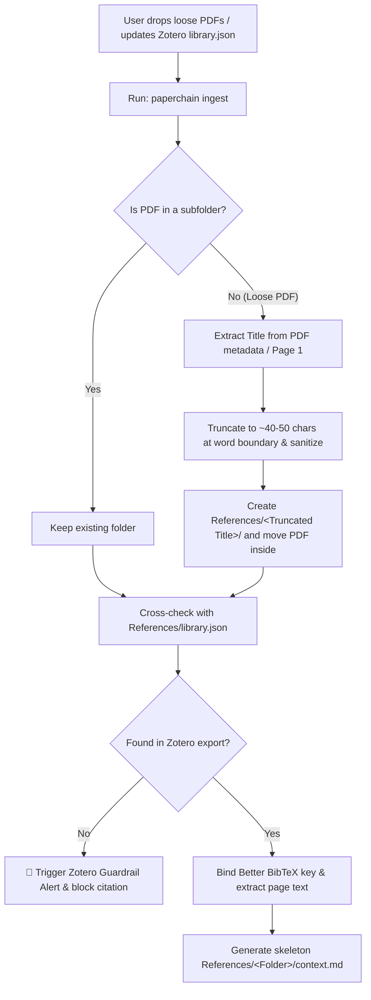

# Paperchain Rewrite Audit & Architecture Blueprint

> ## SUPERSEDED - 2026-11-15
>
> This plan was not carried out as written. Paperchain was changed step by step instead, keeping the verifier, the adapters, the locking and the OS cache. The original text below is kept unchanged for the record; do not build from it. What happened to each part:
>
> | Blueprint item | Outcome |
> | --- | --- |
> | D1 context card beside each PDF | Built as `<name>.context.md` beside the file (`context.py`), not `context.md`, because a folder can hold several references |
> | D2 two-stage context (scaffold, then the writer's resume) | Built. The scaffold lists the standard headings found and a one-line preview of every page; semantic section labels such as "Nuclear Receptor Assays" cannot be produced deterministically, so it does not attempt them |
> | D3 title-based folders | Built (`folders.py`) as `<Title>/<Title>.pdf`, limit 10 characters (`MAX_FOLDER_CHARS`), a long first word kept whole up to 25. The example folder name in Component A could not be produced by any cutting rule |
> | D4 hard Zotero guardrail (`reference_not_in_zotero`) | **Partly covered, the rest open.** When a Zotero export exists, `check` already refuses a citation to a source that has no entry in it (`citation_not_in_bibliography`, confirmed on the sample trial), so such a source cannot reach a build. Not built: an alert at ingestion time that lists every source with no Zotero record before anyone tries to cite it |
> | D5 project-local cache | Not done. The OS cache stays. The junction was only used for `Paper/media`, it is made with `mklink /J` (no elevation) and falls back to a real folder |
> | D6 consolidate to 3-4 commands | Not done. `paperchain start` was added as one safe entry point and no command was removed |
> | Section 4 module plan (remove `locations.py`, `adapters/`, chmod locking; replace `organize.py`) | Not followed. Nothing was removed. New modules: `reference_log.py`, `folders.py`, `context.py`, `start.py`. The 21 modules / 6,048 LOC figures were also wrong (20 modules, 6,784 LOC), and the ~1,800 LOC target was impossible by the plan's own KEEP list |
> | Section 5 "maintains all security guarantees" | Not accurate for the plan as written: removing the adapters, the read-only bits and the external cache would have weakened the guarantee that the writer cannot edit references |
>
> Replaced by: `docs/CHANGELOG.md` (the Unreleased entries) and `docs/audits/AUDIT-LOG.md` Round 7. Moved to `Dump/` on the same date.

**Status:** SUPERSEDED (was: Proposed Architecture for Review)  
**Date:** 2026-11-15  
**Target:** Paperchain v0.4.0 (Agentic Rewrite)  
**Objective:** Transition Paperchain from an over-engineered multi-command scaffolding system into an automated, agent-first engine for drafting academic papers with verified citations.

---

## 1. Executive Summary & Audit Objectives

### Why This Rewrite is Needed
The initial revision and security audits (Rounds 1–5) confirmed that Paperchain's **deterministic quote verifier** (`check.py`) and **page-bounded extraction** (`extract.py`) are mathematically sound and eliminate AI quote hallucination. 

However, the user experience and operational architecture suffer from severe friction:
1. **Fragmented CLI Pipeline:** Requiring 6 sequential manual commands (`init` → `organize` → `import` → `convert` → `match` → `lock`) before a single word can be written.
2. **Context Window Exhaustion:** Forcing the AI to consume 50,000–100,000 tokens of raw extracted text every turn instead of consulting lightweight structured summaries.
3. **External OS Cache Friction:** Storing extracted text in `%LOCALAPPDATA%` and creating Windows junctions/symlinks causes elevation failures, path confusion, and tool isolation.
4. **Heuristic Folder Guessing:** The previous `organize.py` attempted to guess whether loose files were guides, norms, or manuscripts, often sending legitimate files to `Dump/`.

### The New Vision
A lean, automated, 4-stage pipeline:
```
1. INGEST & ORGANIZE  ──>  2. INDEX / CONTEXT CARDS  ──>  3. COLLABORATIVE DRAFTING  ──>  4. VERIFY & BUILD
   • Title-based folders      • CLI metadata scaffold       • User & AI edit Paper/paper.md • check: exact quotes & pages
   • Auto-folder loose PDFs   • AI "Scoped Resume"          • Agent only pulls exact pages  • build: clean Vancouver .docx
   • Zotero guardrail check   • Low-token navigation          when quoting                    (Pandoc Citeproc)
```

---

## 2. Agreed Design Decisions

| # | Design Decision | Old Behavior (v0.3.0) | New Behavior (Rewrite) |
|---|---|---|---|
| **D1** | **Context Card Placement** | Extracted text and indices hidden in `%LOCALAPPDATA%\paperchain\...`. | `References/<Paper Title>/context.md` placed directly beside each PDF. |
| **D2** | **Two-Stage Indexing** | AI forced to read full raw text (`<cache>/text/<key>.txt`) on every prompt. | **Stage 2A:** CLI creates deterministic scaffold with Page Map.<br>**Stage 2B:** AI writes a "Scoped Resume" tailored to the paper's specific thesis. |
| **D3** | **Reference Folder Naming** | Filename stems with hash digests (e.g. `diabetes-study-a1b2c3d4`). | Clean, truncated paper titles (~40–50 chars, word-boundary trimmed, sanitized). Auto-detects paper title for loose files. |
| **D4** | **Zotero Guardrails** | Unlocked exports or unmapped titles caused soft warnings or build-time failures. | Hard guardrail: If a PDF is added that lacks a record in `References/library.json`, ingestion halts for that source and alerts the user immediately. |
| **D5** | **Cache Architecture** | External OS cache requiring Windows directory junctions. | Local `.paperchain/cache/` inside project root (gitignored). Zero symlink/junction friction. |
| **D6** | **CLI Consolidation** | 11 separate subcommands. | 3 primary commands: `paperchain ingest`, `paperchain check`, `paperchain build`. |

---

## 3. Detailed Component Architecture

### Component A: The Reference Ingestion & Folderizer (`paperchain ingest`)



#### Truncation & Sanitization Rules
* Characters stripped: `\ / : * ? " < > | \n \r \t`
* Length: Cut at word boundary at $\le 50$ characters.
* Suffix: No trailing punctuation (`. : / + - _`).
* Example:
  * Raw PDF: `1-s2.0-S094471132200185X-main.pdf`
  * PDF Title: *"Assessment of Herb-Drug Interaction Potential of Five Common Species of Licorice and Their Phytochemical Constituents"*
  * Folder: `References/Herb-Drug Interaction Potential of Licorice/`
  * Files inside:
    * `References/Herb-Drug Interaction Potential of Licorice/paper.pdf`
    * `References/Herb-Drug Interaction Potential of Licorice/context.md`

---

### Component B: The Two-Stage Context Card System

#### Stage 2A: Deterministic Scaffold (CLI Output)
`paperchain ingest` generates the initial `context.md` template automatically:

```markdown
---
citation_key: "haron2023"
title: "Assessment of Herb-Drug Interaction Potential of Five Common Species of Licorice..."
authors: "Haron MH, Avula B, Ali Z, et al."
year: 2023
journal: "Journal of Dietary Supplements"
doi: "10.1080/19390211.2022.2050875"
total_pages: 21
sha256: "c7620b4030f0b5f57dcd60cab2aa829c20936cc2df0bce80819660e3d1a1a9ca"
---

# Haron et al. (2023) — Navigation Card

## Page Map Index
- p. 1-2: Title, Abstract, Introduction to Glycyrrhiza species
- p. 3-4: Materials, Plant Extraction, Nuclear Receptor Assays
- p. 5-7: CYP3A4 & CYP1A2 Enzyme Modulation Protocols
- p. 8-14: Results: PXR Activation, IC50 Tables, Phytochemical Fractions
- p. 15-18: Discussion: Herb-Drug Interaction Risks with Antiretrovirals
- p. 19-21: References

<!-- AGENT SCOPED RESUME BEGINS -->
## Scoped Resume: Relevance to Paper
*(Pending AI synthesis based on Paper/paper.md)*
```

#### Stage 2B: AI Scoped Resume (Agent Protocol)
When instructed, the AI reads `Paper/paper.md` (to understand the thesis) and reviews the extracted text of the reference **once**, replacing the bottom section with:

```markdown
## Scoped Resume: Relevance to Paper
- **Core Relevance:** Provides direct in vitro evidence that Glycyrrhiza extracts induce CYP3A4 and CYP1A2, directly supporting our section on antiretroviral clearance failure.
- **Key Findings & Evidence:**
  - Extracts caused >2-fold (100%) induction in CYP3A4 and CYP1A2 activity (p. 15).
  - G. echinata showed highest CYP3A4 increase (4-fold), while G. uralensis showed 18-fold increase in CYP1A2 (p. 4).
  - Dolutegravir clearance increased 2.8-fold by G. glabra (p. 12).
- **Candidate Verbatim Quotes:**
  - p. 15: "Extracts that showed > 2-fold (100%) induction in CYP3A4 and CYP1A2 activity could significantly enhance the metabolism of drugs which are substrates of these enzymes"
  - p. 4: "the highest increase in CYP3A4 was seen with G. echinata (4-fold)"
```

---

### Component C: The Zotero Guardrail Engine

1. **Strict Sync Rule:** The user is the authoritative curator of references via Zotero.
2. **Missing Record Alert:** If `paperchain ingest` encounters a PDF in `References/` whose title or DOI does not match any entry in `References/library.json`:
   ```json
   {
     "status": "guardrail_mismatch",
     "file": "References/Metabolic Clearance/study.pdf",
     "error": "reference_not_in_zotero",
     "message": "Study found in References/ but has no matching record in References/library.json.",
     "hint": "Add the paper to Zotero, assign a Better BibTeX key, and re-export References/library.json."
   }
   ```
3. **Agent Constraint:** The agent's instructions in `AGENTS.md` strictly forbid citing any reference with an active guardrail alert.

---

### Component D: Verification & Build Engine

The core verification logic remains untouched from the rigorous Round 1–5 audits:
* **`paperchain check`:**
  * Re-hashes all reference PDFs against `paper.toml`.
  * Verifies that every `[@key]` in `Paper/paper.md` resolves to a valid Better BibTeX key.
  * Verifies cited page numbers exist within `total_pages`.
  * Normalizes quotes (NFKC, case, smart quotes, soft hyphens, line wraps) and asserts exact substring presence on the cited page.
  * Enforces the YAML metadata allow-list (`title`, `author`, `abstract`, `keywords`, `lang`).
* **`paperchain build`:**
  * Strips internal quote verification strings: `[@key, p. 12: "quote"]` → `[@key, p. 12]`.
  * Invokes Pandoc with `--citeproc` and `styles/vancouver.csl`.
  * Emits clean, journal-ready `Output/paper.docx` with numeric citations `(1)` and an NLM-formatted reference list.

---

## 4. Codebase Restructuring & Disposition

```
Current State (v0.3.0):  21 modules, 6,048 LOC, complex multi-step CLI
Target State (v0.4.0):   8 core modules, ~1,800 LOC, automated agent pipeline
```

### Module Refactoring Plan

| Current Module | Action | New Destination / Role |
| :--- | :---: | :--- |
| `check.py` | **KEEP** | Retained in full. The mathematical guarantee engine. |
| `extract.py` | **KEEP** | Retained in full. PDF and DOCX text extraction with page maps. |
| `citations.py` | **KEEP** | Retained in full. Parsing, code-masking, quote extraction. |
| `library.py` | **KEEP & EXPAND** | Handles Zotero CSL JSON and powers the Zotero Guardrail check. |
| `build.py` | **KEEP** | Pandoc Citeproc runner and DOCX compiler. |
| `manifest.py` | **KEEP** | Stores `paper.toml` sources, hashes, and Better BibTeX mappings. |
| `organize.py` | **REPLACE** | Replaced by `folderize.py` (Title-based truncation and loose PDF movement). |
| `locations.py` | **REMOVE** | External OS cache removed. All cache paths redirect to `./.paperchain/cache/`. |
| `locking.py` | **SIMPLIFY** | Remove OS `chmod` read-only bits; retain SHA-256 integrity calculation. |
| `adapters/` | **REMOVE** | Dropped. Replaced by a single clean `AGENTS.md` instruction file. |
| `import_cmd.py` | **SIMPLIFY** | Integrated into `ingest` (converts `Manuscript/*.docx` to `Paper/paper.md` if present). |
| `doctor.py` | **SIMPLIFY** | Simplified diagnostic checks (Python, Pandoc, Zotero export presence). |
| `cli.py` | **STREAMLINE** | Surface reduced to 4 primary commands: `ingest`, `check`, `build`, `doctor`. |

---

## 5. Security & Soundness Audit (Preventing Regressions)

The rewrite maintains all security guarantees established in Audit Rounds 1–5:

1. **No YAML Front-Matter Injection (BUG-009 / A5-1):** `FRONT_MATTER_ALLOW` remains strictly enforced. Agents cannot inject `references:` or `suppress-bibliography`.
2. **Punctuation-Safe Keys (BUG-010 / A5-2):** Citation keys must start and end with an alphanumeric character, preventing Pandoc citeproc drops.
3. **Unicode & NFD Normalization (BUG-011 / A5-3):** Accents in titles and author names fold composed and decomposed forms equally.
4. **Indented Code & Media Protection (BUG-014 / A5-6):** Code spans, indented code, and fences are completely masked from path rewriters.
5. **No Hallucinated Citations:** Any quote not appearing verbatim on the designated page halts the build immediately.

---

## 6. Implementation Roadmap

### Phase 1: Ingestion & Title-Based Folderizer
- Implement `folderize.py`: Extract PDF title block, sanitize, word-truncate to $\le 50$ chars, move loose PDFs into `References/<Title>/`.
- Wire `Zotero Guardrail`: Compare discovered references with `References/library.json`; output structured errors for missing items.

### Phase 2: Localized Caching & Context Cards
- Redirect extraction output from `%LOCALAPPDATA%` to `./.paperchain/cache/`.
- Generate skeleton `References/<Title>/context.md` on ingestion, including metadata header and page map.

### Phase 3: CLI Consolidation
- Implement `paperchain ingest` combining folderization, guardrail checks, extraction, and context card generation.
- Update `paperchain check` and `build` to read the local project cache.

### Phase 4: Agent Instructions (`AGENTS.md`)
- Author the streamlined agent protocol:
  1. Triggering `paperchain ingest`.
  2. Generating the Scoped Resume in `context.md` per paper.
  3. Drafting in `Paper/paper.md` using `[@key, p. X: "quote"]`.
  4. Running `paperchain check` before reporting completion.
